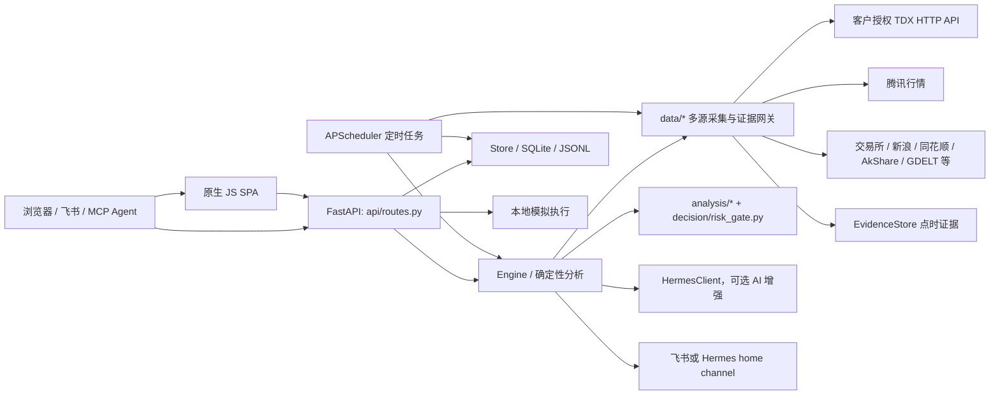

# W.U.D.I. 项目导读（人类 / AI 共读版）

> 适用正式版本：`1.3.0`，归档标签 `v1.3.0`；原始交付基线为 `67e09e58b926e6f77bdd19241213257431ed2cf6`，源码包生成于 `2026-07-19T10:56:37Z`。
>
> 本文依据当前工作区静态源码生成。它描述“代码现在是什么”，不是产品宣传稿，也不替代 `docs/API_CONTRACT.md` 的接口契约。
>
> 本文是交付快照之后新增的阅读辅助文件，因此不在原始 `RELEASE_FILES.sha256` 清单中；若重新打正式发布包，应由发布流程重建清单，不要手工追加单个哈希。

## 1. 一句话理解项目

这是一个面向 A 股研究与交易决策支持的单体 Web 应用：后端用 FastAPI 聚合多路免费/授权行情，执行确定性分析、风险闸门、报告留痕和模拟执行；前端是原生 JavaScript SPA；Hermes/其他模型只负责可选的解释与报告生成，不是行情或交易结论的唯一来源，也不连接券商真实下单。

项目最重要的三条边界：

1. **真实数据优先**：取不到就返回 `missing`、`degraded` 或空值，不用 0 或猜测补齐。
2. **确定性决策优先**：情绪、主线、筛选、风控、推荐回验等核心口径由代码规则计算；AI 只做受约束的解释增强。
3. **只模拟、不实盘**：`simulation.py` 只写本地 SQLite 事件账本，仓库没有券商委托适配器和账户凭据。

## 2. 技术栈与运行形态

| 层 | 技术 / 约定 |
| --- | --- |
| Web 后端 | Python、FastAPI、Uvicorn、APScheduler |
| 数据处理 | AkShare、pandas、腾讯行情、客户授权 TDX HTTP API、交易所/公开网页适配器 |
| 数据存储 | JSON/JSONL、SQLite/WAL、按客户 `data_dir` 隔离 |
| AI 接入 | OpenAI 兼容 `/v1/chat/completions`；Hermes 网关为可选集成 |
| Agent 工具 | FastMCP，只读工具为默认，维护型写入默认关闭 |
| 前端 | 原生 ES Modules、Hash Router、ECharts、Marked、html2canvas、jsPDF |
| 测试 | pytest、pytest-asyncio；大量契约测试直接检查 Python、API 和前端源码语义 |
| 部署脚本 | 主要是 Bash/Linux 形态；另有跨平台 Python 运维脚本 |

正式数据策略固定为 `free_only`。关键行情以客户授权 TDX API、腾讯和公开源组合，公开源没有商业 SLA，因此代码大量使用短超时、缓存、熔断、last-good 和显式降级。

## 3. 总体架构



### 3.1 启动调用链

`python -m hermes_trader --config config.yaml`

1. `hermes_trader/__main__.py` 调用 `main.main()`。
2. `main.create_app()` 加载 `Config`、客户 `Store`、模拟账本、行情证据网关和通知器。
3. 组装 `Engine` 与 APScheduler，注册主线采样、新闻观察、龙虎榜采集和预热任务。
4. 挂载 `/api` 路由，再发现可选 `clients/<id>/ext/` 扩展。
5. 最后把 `frontend/` 挂载为静态 SPA；API 路由必须先于静态 catch-all 注册。

### 3.2 典型业务调用链

- 行情页：`frontend/js/views/*.js` → `api.js` → `api/routes.py` → `data/runtime_gateway.py` 或具体数据模块 → 证据/质量字段 → 前端角标。
- 报告：API/调度器 → `analysis/engine.py` 聚合真实上下文 → `agent/prompts.py` → `HermesClient` → 数字/建议治理闸 → `knowledge/store.py` 定稿 → 交付回执。
- 个股诊断：`/api/diagnose` → `analysis/diagnosis.py` → `data/stock.py` 与证据网关 → 结构化决策卡；深度解释可调用模型，快速路径不依赖模型。
- 推荐闭环：建议草案 → 风险闸/人工批准 → append-only 推荐事件 → 到期真实价格回验 → T0/T1/T2/T5 统计。
- 模拟执行：前端意图 → 服务端重新取风险和行情 → 人工批准 → 本地模拟成交事件；客户端传来的“市场价格”不会被信任。

## 4. 推荐阅读顺序

首次阅读不要从最大的 `routes.py` 开始：

1. `README.md`、本文、`docs/API_CONTRACT.md`：先确定产品边界和契约。
2. `hermes_trader/main.py`：理解装配和生命周期。
3. `hermes_trader/config.py`、`knowledge/store.py`：理解配置优先级和持久化结构。
4. `hermes_trader/api/routes.py`：按端点分组查入口，不建议顺序通读 4675 行。
5. `hermes_trader/data/runtime_gateway.py`、`gateway.py`、`evidence_store.py`：理解数据真实性主干。
6. `hermes_trader/analysis/engine.py`、`decision/risk_gate.py`：理解报告与风控主干。
7. `frontend/js/navigation.js`、`app.js`、目标 `views/*.js`：理解前端工作台。
8. 修改功能前，先按同名 `tests/test_*.py` 反查不可破坏的契约。

### 4.1 体量热点

这些文件职责偏重，AI 修改时应缩小阅读范围并优先依赖测试：

| 文件 | 约行数 | 风险 |
| --- | ---: | --- |
| `hermes_trader/api/routes.py` | 4675 | API、校验、SSE、设置和 CRUD 集中，改动影响面大 |
| `hermes_trader/analysis/engine.py` | 2335 | 数据聚合、报告、聊天、治理与落盘的核心编排 |
| `hermes_trader/analysis/diagnosis.py` | 1956 | 快速/深度诊断、证据与价格位校验交织 |
| `hermes_trader/data/market.py` | 1694 | 市场级数据和多种回退口径集中 |
| `hermes_trader/knowledge/store.py` | 1638 | 多类业务数据共用文件存储层 |
| `frontend/js/views/chat.js` | 1258 | SSE 对话、个股侧栏、多个问答模式 |
| `frontend/js/views/cockpit.js` | 1098 | 首页多卡片、渐进加载与多个后端契约 |
| `frontend/js/app.js` | 1043 | 路由、导航、状态、扩展视图和生命周期 |

## 5. 顶层目录

| 目录 | 作用 | 是否应直接修改 |
| --- | --- | --- |
| `hermes_trader/` | 后端、分析、数据、Agent、任务、MCP、持久化 | 是，核心源码 |
| `frontend/` | 原生 JS SPA、CSS、内置第三方前端库 | 自有源码可改；`vendor/` 谨慎 |
| `tests/` | 79 个契约/回归测试文件 | 改功能时同步补测 |
| `scripts/` | 验收、备份、TDX 探测、受限 Hermes 启动脚本 | 运维逻辑，可改但需独立验证 |
| `docs/` | API、MCP、安全审计说明 | 契约变化时必须同步 |
| `examples/` | 示例目录占位 | 当前只有 `data/.gitkeep` |
| `data/` | 默认运行数据目录 | 当前会话无权限枚举；视为运行态数据，不纳入源码修改 |
| `.agents/` | Agent 相关目录 | 当前为空 |
| `.git/` | 名义上的 Git 目录 | 当前快照中不可作为有效仓库使用；`git status` 报“not a git repository” |

## 6. 顶层文件说明

| 文件 | 说明 |
| --- | --- |
| `README.md` | 交付包简介、Unix 快速启动、部署地域配置和测试命令。 |
| `SOURCE_DELIVERY.txt` | 版本、生成时间、基线提交、隔离范围和“不含真实客户数据/实盘交易”的交付声明。 |
| `config.example.yaml` | 无凭据的完整启动模板：客户、服务、Hermes、Agent 权限、MCP、飞书、调度、数据源及功能开关。 |
| `config.yaml` | 当前启动配置；本快照中 SHA-256 与 `config.example.yaml` 完全一致，仍是中性模板。 |
| `.env.example` | 环境变量模板。 |
| `.env` | 当前环境文件；本快照中 SHA-256 与 `.env.example` 完全一致，未发现快照内额外配置。 |
| `requirements.txt` | 生产依赖及数据源/平台依赖说明。 |
| `requirements-dev.txt` | 复用生产依赖并加入 pytest、pytest-asyncio。 |
| `pytest.ini` | 测试目录、严格 asyncio 模式和 `cloud` 标记。 |
| `run.sh` | Bash 启动器：载入 `.env`，优先 `.venv/bin/python`，否则用 `uv`，再启动模块。 |
| `RELEASE_FILES.sha256` | 交付文件完整性清单，用于发现缺失或篡改。 |

## 7. 后端 `hermes_trader/`

### 7.1 包根文件

| 文件 | 职责 |
| --- | --- |
| `__init__.py` | 包说明和版本常量 `1.3.0`。 |
| `__main__.py` | `python -m hermes_trader` 的最小入口。 |
| `main.py` | FastAPI 装配、应用生命周期、中间件、状态对象、扩展发现、静态前端挂载和 CLI。 |
| `config.py` | YAML + `${ENV}` 展开 + `data/settings.json` 运行时覆盖；处理部署地域、模型连接、权限和敏感配置脱敏。 |
| `delivery.py` | append-only 交付回执、内容 ID、渠道规范化、投递就绪度与每日交付闸。 |
| `delivery_outbox.py` | SQLite 持久 outbox；用确定性 ID 保证投递意图幂等，区分已接受、超时不明和人工复核。 |
| `ext_loader.py` | 自动发现 `clients/<id>/ext/*.py` 的 router、视图和任务；实现 visible/hidden/retired/redirect 生命周期。 |
| `gateway_home_delivery.py` | 产品到 Hermes home channel 的受认证桥；只允许平台和内容，不接收任意收件人 ID。 |
| `integrity.py` | 对 `hermes_trader/` 与 `frontend/` 生成/校验核心 SHA-256 清单和指纹。 |
| `mcp_server.py` | 独立 stdio MCP Server；暴露市场、资金、决策、公告、任务、回执等只读工具。 |
| `notify.py` | `GatewaySender`，通过 Hermes `/sethome` 绑定的唯一 home channel 推送。 |
| `product_state.py` | 北京时间交易阶段、推荐路由和旧路由重定向的确定性状态机。 |
| `simulation.py` | 无券商连接的 SQLite 模拟订单状态机、幂等和追加式审计事件。 |

### 7.2 `agent/`：模型接入层

| 文件 | 职责 |
| --- | --- |
| `agent/__init__.py` | 子包标记。 |
| `agent/hermes_client.py` | OpenAI 兼容客户端；处理流式请求、重试、能力证明、受限工具门禁、错误脱敏和运行审计。 |
| `agent/prompts.py` | 系统人格、各类报告/聊天模板、真实数据注入、金额可读化和客户 persona/output directive。 |
| `agent/run_store.py` | Agent 运行审计账本；只记哈希、字节数、能力状态和终态，不保存 prompt/原文/工具内容。 |

### 7.3 `analysis/`：确定性分析与受治理报告

| 文件 | 职责 |
| --- | --- |
| `analysis/__init__.py` | 子包标记。 |
| `analysis/advice_proposal.py` | 建议草案 append-only 状态机；草案不计入正式推荐统计。 |
| `analysis/claim_validator.py` | 报告交易价格硬闸；价格必须绑定同一股票的真实证据，截断报告不得定稿。 |
| `analysis/cockpit.py` | 驾驶舱风险等级、仓位上限、允许/禁止动作、系统性风险等确定性映射。 |
| `analysis/diagnosis.py` | 个股结构化诊断卡；管理快速/深度路径、证据覆盖、价格位合法性和模型降级。 |
| `analysis/engine.py` | 核心编排器；采集上下文、生成报告/聊天流、治理内容、写入报告/推荐并触发推送。 |
| `analysis/features.py` | 题材赚钱效应、拥挤度、主线、情绪龙头和机构容量票特征。 |
| `analysis/forecast_mining.py` | 业绩预告规则筛选；披露时点、基数陷阱、扣非疑点均由规则判定。 |
| `analysis/industry_chain.py` | 产业链研究契约；严格区分 TDX 成员事实、研究框架和待核验推演。 |
| `analysis/mainline.py` | 当日行业主线四因子规则、领涨角色和催化证据绑定。 |
| `analysis/mainline_runtime.py` | API 与后台任务共用的当前主线组装及 last-good 快照。 |
| `analysis/mainline_timeline.py` | 10 分钟主线观察档、候选/形成/确认/撤退和跨日持续性。 |
| `analysis/methodology.py` | 把方法论 Markdown 蒸馏成有长度上限的模型提示片段。 |
| `analysis/premarket_brief.py` | 盘前“可买候选池”规则：排除封板、低流动性、极端市值、ST/次新等。 |
| `analysis/quant.py` | 沪深 300 截面因子、因子有效性与无未来函数的双均线回测。 |
| `analysis/recommend.py` | 推荐事件、恢复意图、真实价格回验、T0/T1/T2/T5 统计和 MFE/MAE 契约。 |
| `analysis/report_eval.py` | 报告数字反查注入数据的质检；当前侧重标注，不自动改写正文。 |
| `analysis/report_lineage.py` | 报告内容哈希、版本、父报告和上游证据 lineage。 |
| `analysis/score_lock.py` | 评分按 10 分钟槽定格，原子落盘并限制结论跳变；实时价格不锁。 |
| `analysis/screener.py` | 全市场条件/多因子筛选；要求股票池覆盖率至少 80%。 |
| `analysis/sentiment.py` | 涨跌停、宽度、连板、炸板和昨日溢价合成的透明情绪周期评分。 |
| `analysis/sentinel.py` | 数据/推送运行哨兵；确定性自检、告警和对已定稿未送达报告的补推。 |
| `analysis/stock_analysis_contract.py` | 冻结“规则选股 → 受治理诊断 → AI 仅解释”的共享执行契约。 |
| `analysis/timing.py` | 价量均线四区域择时和五因子贪恐温度计。 |
| `analysis/watchlist_zones.py` | 观察池双周期纯数字区间；用前复权日线与 5 分钟 OHLCV/成交额确定性计算超短线、波段区间，并管理同交易日降级快照。 |

### 7.4 `api/`：HTTP 接口层

| 文件 | 职责 |
| --- | --- |
| `api/__init__.py` | 子包标记。 |
| `api/routes.py` | `/api` 的全部 REST/SSE 接口：状态、任务、行情、证据、诊断、聊天、报告、交付、持仓、观察池、推荐、知识库、存档、设置、特征、量化、新闻、DIY 和推送。完整字段契约见 `docs/API_CONTRACT.md`。 |

主要端点族：

- 系统：`/shell-status`、`/status`、`/jobs`、`/agent/*`。
- 数据：`/market/*`、`/market-data/*`、`/evidence/*`、`/stock/*`、`/quote(s)`、`/news/*`。
- 决策：`/cockpit`、`/pulse`、`/sysrisk`、`/risk/evaluate`、`/diagnose`、`/features/*`、`/timing`、`/quant/*`、`/screen`。
- 内容：`/chat`、`/reports/*`、`/knowledge/*`、`/archive/*`、`/diy/*`。
- 闭环：`/recommendations*`、`/advice-proposals`、`/delivery/*`、`/simulation/*`。
- 管理：`/holdings`、`/watchlist`、`/settings*`、`/datasources`、`/push/test`。

### 7.5 `data/`：数据源、质量契约与点时证据

| 文件 | 职责 |
| --- | --- |
| `data/__init__.py` | 子包标记。 |
| `data/base.py` | TTL 缓存、安全调用、线程池、代理/中继、熔断、来源指标、北京时间与交易日历。 |
| `data/deployment.py` | 把显式 `cn_home/cn_server/overseas_server` 配置翻译为可检查的路由策略；不做 IP 猜测。 |
| `data/gateway.py` | 与供应商无关的字段级路由器、质量判定、回退、冲突和证据写入。 |
| `data/runtime_gateway.py` | 将 TDX 与腾讯快照适配为生产字段策略，统一代码、时点、单位和批次语义。 |
| `data/evidence_contract.py` | `data-evidence-v1` 来源、时点、完整性和内容哈希契约。 |
| `data/evidence_store.py` | SQLite 点时证据库；存来源、原始载荷、标准化点和谱系，支持严格 PIT 读取。 |
| `data/market.py` | 指数、市场宽度、涨跌停、板块、资金、涨幅榜等市场级聚合与回退。 |
| `data/stock.py` | 个股实时盘口、快速报价、分时、日 K、板块和资金的渐进式详情。 |
| `data/free_source.py` | 免费数据兼容层；统一腾讯、TDX、AkShare/新浪/同花顺等常用能力。 |
| `data/tdx_api_source.py` | 客户授权 TDX Data API v2.8 适配；代码表、行情、板块、资金和盘后研究。 |
| `data/tencent_source.py` | 腾讯 `qt.gtimg.cn` 行情适配；补实时、估值、港美股和指数。 |
| `data/xverify.py` | TDX/腾讯/新浪跨源价格核对，输出高可信、单源、存疑或无数据。 |
| `data/akshare_isolated.py` | 在子进程执行高风险 AkShare/MiniRacer 调用并维护熔断。 |
| `data/akshare_worker.py` | 一次性 AkShare worker；V8 崩溃只影响子进程。 |
| `data/universe_worker.py` | 可硬终止的 TDX 股票池阻塞 worker。 |
| `data/bootstrap_universe.py` | 2026-07-10 官方股票池压缩快照；仅在官网、TDX 和 last-good 都不可用时托底，必须标 stale。 |
| `data/official_universe.py` | 沪、深、北交易所官方股票列表的独立有界抓取。 |
| `data/capital_tracker.py` | 行业/热门股资金快照写 SQLite 并提供排名和历史趋势。 |
| `data/cls_news_source.py` | 财联社 7×24 电报网页适配、签名、解析和 last-good。 |
| `data/gdelt_source.py` | GDELT 官方 DOC API 的低频全球事件元数据，不复制正文。 |
| `data/news.py` | 财联社、TDX、GDELT、腾讯等消息聚合、去重、时点和多市场新闻。 |
| `data/news_mapping.py` | 新闻到 A 股公司/行业/概念的确定性映射，不判断利多利空。 |
| `data/news_observation.py` | 新闻事件与后续盘面观察的客户隔离 append-only 账本。 |
| `data/official_disclosure.py` | 巨潮与交易所公司公告双路径、证据状态、PDF 可选哈希和 last-good。 |
| `data/official_interaction.py` | 深交所互动易管理层回复适配；明确其不是法定公告。 |
| `data/official_longhu_source.py` | 沪深交易所官方龙虎榜解析、状态、盘后缓存和完整快照。 |
| `data/mainforce_source.py` | 盘后龙虎榜、机构席位与行业资金；北向净流入已按停止披露事实禁用。 |
| `data/deriv_source.py` | 股指/商品期货与 ETF 期权概览；各段独立降级。 |
| `data/overseas_source.py` | 美股/港股个股行情和基础财务，保留市场时区与本币口径。 |
| `data/sources.py` | 汇总已有调用埋点形成数据源健康面板，不为面板额外抓取。 |

### 7.6 `decision/`：纯确定性决策控制

| 文件 | 职责 |
| --- | --- |
| `decision/__init__.py` | 导出风险闸数据类、规则版本和评估函数。 |
| `decision/risk_gate.py` | 不依赖模型/网络的盘前风险策略引擎；只返回 `allow/reduce/veto` 和可审计理由。 |

### 7.7 `feishu/`：飞书交互和推送

| 文件 | 职责 |
| --- | --- |
| `feishu/__init__.py` | 子包标记。 |
| `feishu/bot.py` | 可选长连接机器人；支持代码问股、报告、持仓和自由问答，并记录 home 会话。 |
| `feishu/push.py` | Webhook 与应用 Bot API 双通道，长文分片、签名、home chat 和文件附件。 |

### 7.8 `jobs/`：后台调度

| 文件 | 职责 |
| --- | --- |
| `jobs/__init__.py` | 子包标记。 |
| `jobs/scheduler.py` | 六个核心交易日任务、任务状态、手工运行和客户扩展任务注册。 |
| `jobs/mainline_sampler.py` | 交易时段主线时间轴采样。 |
| `jobs/news_event_observer.py` | 新闻事件后续盘面观察采样。 |
| `jobs/official_longhu_collector.py` | 盘后有界采集官方龙虎榜并落精确交易日快照。 |
| `jobs/prewarmer.py` | 交易时段预热热点函数、写/读市场 last-good，减少用户冷请求等待。 |

默认核心时点：08:50 早报、14:45 尾盘草案、14:52 尾盘定稿、15:30 收盘、19:30 次日/趋势、22:00 归档。实际运行以 `config.yaml` 和 `data/settings.json` 覆盖为准。

### 7.9 `knowledge/`：业务存储和方法论

| 文件 | 职责 |
| --- | --- |
| `knowledge/__init__.py` | 子包标记。 |
| `knowledge/store.py` | 报告、存档、情绪、持仓、观察池、推荐、知识、对话、任务状态等客户文件存储总入口。 |
| `knowledge/methodology/chaoguyangjia-method.md` | 炒股养家式情绪、合力、龙头、仓位与纪律。 |
| `knowledge/methodology/dragon-head-tactics.md` | 龙头识别、梯队、操作模式、择时和风控。 |
| `knowledge/methodology/my-trading-notes.md` | 用户个人经验库占位和追加模板。 |
| `knowledge/methodology/regime-factor-matrix.md` | 不同情绪相位下各类因子的权重与使用纪律。 |
| `knowledge/methodology/sentiment-cycle.md` | 情绪周期相位、量化指标和切换信号。 |
| `knowledge/methodology/short-term-technical.md` | 均线、量价、分时、形态、题材和纪律。 |
| `knowledge/methodology/wyckoff-vsa.md` | Wyckoff/VSA 的循环、吸筹、派发和量价信号。 |

## 8. 前端 `frontend/`

### 8.1 页面骨架与样式

| 文件 | 职责 |
| --- | --- |
| `frontend/index.html` | SPA 壳、首屏主题防闪、版本化 CSS/JS、ECharts/Marked 全局加载。 |
| `frontend/css/app.css` | 主设计系统：暗/亮主题、间距/字号 token、终端式卡片、全站组件和页面样式。 |
| `frontend/css/responsive.css` | 手机/平板/桌面响应式增强、侧栏抽屉和可访问性布局。 |

### 8.2 前端基础模块

| 文件 | 职责 |
| --- | --- |
| `frontend/js/app.js` | SPA 启动、Hash 路由、6+2 工作台、叶子页懒加载、主题、导航、扩展视图和全局状态。 |
| `frontend/js/navigation.js` | 不依赖 DOM 的路由/工作台契约、旧 hash 重定向和页签解析。 |
| `frontend/js/api.js` | HTTP、SSE、单飞/会话缓存、AI 就绪检查、格式化、本地存储和共享状态。 |
| `frontend/js/ui.js` | 图标、Markdown 安全渲染、toast、modal、骨架、空态和数据新鲜度角标。 |
| `frontend/js/charts.js` | ECharts 双主题和 K 线、分时、树图、仪表、资金、持仓、情绪等 option。 |
| `frontend/js/evidence.js` | 字段级证据抽屉，展示来源、质量、时点、缺失和跨源对账。 |
| `frontend/js/export.js` | 按需加载 html2canvas/jsPDF，把页面导出为 A4 PDF，并可交给后端推送。 |
| `frontend/js/freshness.js` | 页面常驻时的连接/阶段刷新协调；避免重挂整个工作台打断输入。 |
| `frontend/js/live.js` | 真实数值变化时滚动/闪烁；不制造假跳动。 |
| `frontend/js/swr.js` | localStorage stale-while-revalidate，先显示 last-good 再后台更新。 |

### 8.3 业务视图 `frontend/js/views/`

所有正常业务视图都导出 `mount()`/`unmount()`；`app.js` 负责生命周期和懒加载。

| 文件 | 页面/作用 |
| --- | --- |
| `_chain_shared.js` | 问股和研究中心共用的产业链请求契约。 |
| `_intel_hero.js` | 首页“外盘领先 → A 股映射”资讯组件；映射只是传导参考，不冒充因果。 |
| `_recommend_review.js` | T0/T1/T2/T5 推荐回验的共享前端语义。 |
| `_report_page.js` | 尾盘、收盘、次日报告页共用的查看/生成/推送/PDF 组件。 |
| `archive.js` | 按日期回看已归档报告。 |
| `capital.js` | 行业/热门股资金时序和排行榜。 |
| `chain.js` | 产业链结构化研究、SSE 渐进兼容、历史和知识库存入。 |
| `chat.js` | 核心问股页：自由问答、个股、持仓、产业链四模式及盘口侧栏。 |
| `close.js` | 收盘复盘报告与推荐留痕回验。 |
| `cockpit.js` | 今日决策驾驶舱，汇总风险、市场结构、资金、主线和候选。 |
| `company.js` | 单公司九段式深度研究、官方公告底座、历史和知识库存入。 |
| `dashboard.js` | 大盘总览：指数、情绪、涨停、板块、资金、排行和任务时间线。 |
| `diagnosis.js` | 个股结构化证据链决策卡。 |
| `diy.js` | 自定义研究模板管理和 SSE 执行。 |
| `evening.js` | 次日策略报告和明日观察池排序。 |
| `features.js` | 赚钱效应、拥挤度、市场主线和龙头梯队。 |
| `forecast.js` | 中报/年报业绩预告确定性规则榜单。 |
| `holdings.js` | 持仓编辑、实时盈亏、仓位图和建议复核。 |
| `hotboard.js` | 独立同花顺口径的涨停题材池，不与驾驶舱口径混算。 |
| `institutional.js` | AI/半导体方向的机构容量票表。 |
| `knowledge.js` | 知识分类、搜索、审批、拒绝、替代和删除。 |
| `macro.js` | 原油、黄金等 A 股风险偏好辅助信号；未接数据不显示虚构点位。 |
| `mainforce.js` | 盘后龙虎榜机构净买和行业资金。 |
| `morning.js` | 盘前交易计划和“今天能不能做”的风险面板。 |
| `overseas.js` | 美股/港股个股行情与基础财务。 |
| `quant.js` | 沪深 300 因子排名、因子评估和双均线回测。 |
| `recommend.js` | append-only 推荐历史和 T0/T1/T2/T5 成功率。 |
| `reports.js` | 全报告中心：查看、SSE 生成、PDF 和推送。 |
| `restructuring.js` | 用户材料驱动的重组事件深度拆解。 |
| `screener.js` | 条件/多因子全市场筛选，结果可跳转诊断。 |
| `senti.js` | 新闻事件流、A 股实体/板块映射和后续观察。 |
| `sentiment.js` | 情绪周期与历史图表。 |
| `settings.js` | 任务、数据、交付、模型连接、安全和版本设置。 |
| `simulation.js` | 本地模拟订单、人工批准、成交和紧急停止。 |
| `tail.js` | 尾盘策略报告、风险闸、推荐战绩和观察池机会。 |
| `timing.js` | 贪恐温度、多指数/个股四区域资金择时。 |
| `watchlist.js` | “想买但未买”的观察池、触发区间和失效条件。 |
| `datasources.js` | 已退役数据源页墓碑；保留文件是为了兼容旧浏览器模块缓存。 |
| `deriv.js` | 已退役期货期权页墓碑。 |
| `sanshi.js` | 已退役“三势”页墓碑。 |

### 8.4 `frontend/vendor/`：内置第三方资产

| 文件 | 说明 |
| --- | --- |
| `echarts.min.js` | ECharts UMD 构建。 |
| `marked.min.js` | Markdown 解析器。 |
| `html2canvas.min.js` | 页面截图，导出时按需加载。 |
| `jspdf.umd.min.js` | PDF 生成，导出时按需加载。 |
| `phosphor/style.css` | Phosphor 图标字体样式。 |
| `phosphor/Phosphor.woff2` | 图标字体。 |
| `phosphor/LICENSE` | Phosphor 许可文本。 |

不要手工格式化或局部修改压缩库；升级应替换完整上游文件并核对许可证、版本和 `index.html` 缓存参数。

## 9. 运维脚本 `scripts/`

| 文件 | 说明 |
| --- | --- |
| `check_clock.sh` | 扫描后端裸本地时钟调用，强制业务时间统一走北京时间函数。 |
| `client_runtime.sh` | 为多客户开发仓库/单客户交付包解析 `clients/<id>` 上下文。 |
| `data_backup_restore.py` | fail-closed 数据备份、清单校验、SQLite 在线快照、恢复与演练；拒绝路径穿越和覆盖非空目录。 |
| `init_restricted_hermes_profile.sh` | 从客户模板初始化权限收敛的 Hermes profile 和凭据文件。 |
| `production_acceptance.py` | 只发 GET 的上线验收门禁；检查核心路由、free_only、Agent 权限、交付、时钟、新鲜度等。 |
| `restricted_hermes_proxy.py` | 启动受限 Hermes 子进程、环境变量白名单、HMAC 进程证明和受认证反向代理。 |
| `run_restricted_hermes.sh` | 校验客户 profile 未漂移后启动受限代理。 |
| `tdx_dataset_probe.py` | 凭据安全的 TDX 数据集探针；只输出计数、日期、覆盖率和一致性，不打印 URL/key/完整行。 |

## 10. 文档与示例

| 文件 | 说明 |
| --- | --- |
| `docs/API_CONTRACT.md` | 前后端唯一接口事实来源；详细记录字段、枚举、降级语义、模拟执行和运维契约。 |
| `docs/MCP_READ_ONLY_CAPABILITIES.md` | MCP 工具目录、只读边界、默认禁用写能力和诚实降级。 |
| `docs/审计流程.md` | 部署、时区、任务、数据真实性、前端、安全和仓库卫生的完整 SOP。 |
| `examples/data/.gitkeep` | 保留空示例数据目录。 |

## 11. 测试目录 `tests/`

测试文件名基本与契约一一对应。以下说明覆盖当前全部 79 个测试文件。

### 11.1 决策、报告、推荐与交付

| 文件 | 主要覆盖 |
| --- | --- |
| `test_advice_proposals.py` | 建议草案状态、快照和不进入推荐统计。 |
| `test_archive_advice_snapshot.py` | 归档冻结建议/执行/回验账本，历史归档不重建。 |
| `test_claim_validator.py` | 报告价格验证和未验证报告禁止推送。 |
| `test_cockpit_fast_snapshot.py` | 驾驶舱/主线 last-good 快照。 |
| `test_cockpit_progressive_loading.py` | 驾驶舱渐进加载和请求节奏。 |
| `test_cockpit_risk_levels.py` | 五级风险、仓位上限和动作单调性。 |
| `test_company_report_governance.py` | 盘后公司报告交易段的确定性治理。 |
| `test_delivery_outbox.py` | 投递幂等、模糊超时和并发 intent。 |
| `test_delivery_receipts.py` | 交付回执追加、权限、状态和正文隔离。 |
| `test_diagnosis_evidence.py` | 快速/深度诊断、价格位、证据与非股票拒绝。 |
| `test_engine_sse_error_sanitization.py` | SSE 生成各阶段错误脱敏。 |
| `test_feishu_advice_governance.py` | 飞书问股/持仓走同一受治理路径。 |
| `test_recommendation_events.py` | 推荐事件结构、证据和 append-only。 |
| `test_recommendation_review_frontend_v2.py` | 前端四窗口与不可评分状态语义。 |
| `test_recommendation_review_v2.py` | 触发条件、目标日、MFE/MAE 和回验路径。 |
| `test_report_advice_governance.py` | 报告禁直接下单语言及高风险限制。 |
| `test_report_lineage.py` | 报告只创建一次、并发定稿和 lineage。 |
| `test_risk_gate.py` | allow/reduce/veto、风险五买入阻断和中文动作归一。 |
| `test_stock_analysis_pipeline_contract.py` | 规则选股、诊断、AI 仅解释的统一管线。 |
| `test_tail_decision_lifecycle.py` | 草案/定稿/晚报的生成、推送与就绪边界。 |
| `test_task_output_artifacts.py` | 任务产物可追踪但不泄露正文/路径。 |

### 11.2 数据源、证据与市场口径

| 文件 | 主要覆盖 |
| --- | --- |
| `test_capital_tracker_tdx_v28.py` | TDX 资金原始单位、持久化和单位切换。 |
| `test_cls_news_source.py` | 财联社签名、解析、字段漂移和 last-good。 |
| `test_evidence_contract.py` | 北京业务时点、UTC 抓取时点和稳定哈希。 |
| `test_feature_score_coverage.py` | 特征评分覆盖率和部分因子。 |
| `test_features_transport_semantics.py` | 传输失败与真实空样本严格区分。 |
| `test_free_runtime_sources.py` | 腾讯日线、质量语义和无 V8 热路径。 |
| `test_free_source_contract.py` | 单位、跌停名称、筛选覆盖率和 free_only。 |
| `test_free_universe_resilience.py` | 交易所部分失败、last-good 过期和股票池状态。 |
| `test_gdelt_source.py` | 国内部署跳过跨境增强、海外只取元数据。 |
| `test_interactive_source_budgets.py` | 无本地 TDX SDK、抓取预算和降级。 |
| `test_intraday_pool_fallbacks.py` | 盘中涨跌停池同一时点回退。 |
| `test_longhu_buyable_release_gate.py` | 可买池、龙虎榜完整/回退/结算状态。 |
| `test_mainline.py` | 主线容量、方向、宽度、涨停和资金不误导。 |
| `test_market_data_gateway.py` | 证据库 WAL、去重、PIT、回退、冲突和质量。 |
| `test_news_a_share_mapping.py` | 股票/行业/概念映射和盘面观察时点。 |
| `test_news_freshness_contract.py` | 新闻刷新、聚合和非空 last-good。 |
| `test_news_observation.py` | 事件观察状态机、交易日和追加幂等。 |
| `test_official_disclosure.py` | 巨潮/上交所/深交所公告解析、精度和 PDF。 |
| `test_official_interaction.py` | 互动易请求形态、问答时点和未回复语义。 |
| `test_official_longhu_cache_integration.py` | 主力页与官方龙虎榜缓存交叉核对。 |
| `test_official_longhu_collector.py` | 采集配置、调度、保存和闭市跳过。 |
| `test_official_longhu_source.py` | 沪深龙虎榜、席位单位、分页和完整状态。 |
| `test_quant_backtest_windows.py` | 回测完整窗口、历史不足拒绝和无 V8 回退。 |
| `test_runtime_gateway.py` | 字段单位/路由、代码规范和快照缓存。 |
| `test_source_contract.py` | 数据源目录与实际字段路由、海外中继缺口。 |
| `test_stock_progressive_contract.py` | 个股分段加载、TDX 板块和并发槽释放。 |
| `test_tdx_api_source.py` | TDX v2.8 代码、单位、盘口、分页和完整股票池。 |
| `test_trade_day_reconciliation.py` | 相邻交易日、回退和晚报目标日期。 |
| `test_trading_calendar_gate.py` | 日历不可用时工作日未知、周末明确闭市。 |
| `test_v8_source_safety.py` | 不可取消源、缓存锁和 MiniRacer 进程隔离。 |

### 11.3 API、配置、安全、Agent 与运维

| 文件 | 主要覆盖 |
| --- | --- |
| `test_agent_reliability.py` | 受限 profile、MCP 白名单、HMAC 能力证明和运行审计。 |
| `test_config_security.py` | 设置脱敏、网关 key 复用和客户文件权限。 |
| `test_data_backup_restore.py` | 备份/恢复完整性、排除项、路径安全和 SQLite。 |
| `test_gateway_home_delivery.py` | home 平台白名单、媒体路径约束和任意文件拒绝。 |
| `test_mcp_server.py` | MCP 工具目录、读写边界、Web 口径复用和错误脱敏。 |
| `test_model_connections_api.py` | 多模型连接 CRUD、切换和 key 不回传。 |
| `test_phase2_evidence_api.py` | 应用装配、行情字段 API 和证据查询。 |
| `test_phase3_governance_api.py` | 行业批量门禁与知识审批 API。 |
| `test_product_state_contract.py` | 北京时间阶段、推荐路由和重定向。 |
| `test_production_acceptance.py` | 上线验收全部阻断项和 SPA 壳识别。 |
| `test_restricted_client_runtime.py` | 单/多客户上下文解析和显式客户要求。 |
| `test_settings_product_semantics.py` | 交付状态、就绪度和真实重试动作。 |
| `test_settings_security.py` | 模型端点 SSRF 防护和飞书官方域名校验。 |
| `test_simulation.py` | 人工批准、整手、风险、成交、幂等和紧急停止。 |

### 11.4 前端、研究功能与业务闭环

| 文件 | 主要覆盖 |
| --- | --- |
| `test_chain_frontend_contract.py` | 问股产业链共享请求和研究/交易分离。 |
| `test_chain_frontend_contract_v2.py` | 产业链结构化/旧流兼容和必备研究维度。 |
| `test_chain_sector_alias.py` | TDX 板块别名匹配但不猜成员。 |
| `test_company_disclosure_frontend.py` | 公司页公告面板和完整/降级/缺失语义。 |
| `test_company_official_evidence.py` | 公司研究上下文的官方证据与降级。 |
| `test_free_chat_stock_injection.py` | 自由问答股票识别、歧义和未知代码。 |
| `test_frontend_api_cache.py` | GET 单飞缓存、超时释放和重试。 |
| `test_frontend_workspace_runtime_contract.py` | 工作台不被后台刷新重挂、导航可达性和默认入口。 |
| `test_hotboard_frontend.py` | 涨停题材独立口径和懒加载可见性。 |
| `test_industry_chain_analysis.py` | 真实 TDX 成员、可复算评分和八段研究结构。 |
| `test_knowledge_governance.py` | 手工知识、自动草稿、审批证据和 digest 隔离。 |
| `test_mainforce_official_verification_frontend.py` | 主力页官方核验状态与代码集合比较。 |
| `test_phase5_accessibility_frontend.py` | 风险配色和 WCAG AA 可读性。 |
| `test_phase5_responsive_frontend.py` | 量化、问股、尾盘和移动断点。 |

## 12. 运行数据结构（来自源码约定）

`server.data_dir` 默认是 `./data`。`Store` 和各子模块会在其中创建或读取类似结构：

```text
data/
├─ reports/YYYY-MM-DD/{rtype}.json
├─ archive/YYYY-MM-DD.json
├─ sentiment/history.json
├─ knowledge/items.json
├─ holdings.json
├─ watchlist.json
├─ watchlist_zones.json
├─ settings.json
├─ simulation.sqlite3
├─ evidence/market_data.sqlite3
├─ delivery_receipts/
├─ news_events/
└─ 各类 last-good、主线、龙虎榜、任务与缓存文件
```

注意：当前会话对仓库根 `data/` 的枚举被拒绝，所以本文没有假定它为空，也没有读取任何运行态内容。运行数据通常含用户持仓、报告和设置，不应随源码提交或交给无关 AI。

## 13. 配置优先级和重要开关

配置优先级：`data/settings.json` 运行时覆盖 > `.env` 展开 > `config.yaml` 字面值。

| 配置 | 含义 |
| --- | --- |
| `server.data_dir` | 客户运行数据隔离根。 |
| `data_source.policy` | 当前只允许 `free_only`。 |
| `data_source.deployment_profile` | 必须按真实部署选 `cn_home/cn_server/overseas_server`；不要自动猜 IP。 |
| `data_source.eastmoney_direct` | 是否允许东财直连作为公开备用。 |
| `hermes.*` | 可选模型网关、模型、超时和生成参数。 |
| `agent_runtime.*` | Agent 最小权限、允许的 toolsets/MCP 和 profile 进程证明。 |
| `mcp.allow_write_tools` | 默认 `false`；只影响少数明确的维护型写工具。 |
| `push.enabled` / `push.via` | 是否推送以及走飞书还是 Hermes gateway。 |
| `capital_tracking.enabled` | 是否创建资金时序库并定时采样。 |
| `news_event_observation.enabled` | 是否建立新闻事件观察闭环。 |
| `official_longhu.enabled` | 是否启用官方龙虎榜盘后采集。 |

敏感信息规则：API 的设置视图只返回 `*_set` 布尔值，不回传 webhook、secret 或 API key；Agent 运行账本也不保存 prompt 和原文。

## 14. 给 AI 的修改纪律

1. **先定位契约**：API 改动先读 `docs/API_CONTRACT.md`、`api/routes.py` 和对应前端；数据字段改动还要读 `evidence_contract.py`、`runtime_gateway.py`。
2. **不得把缺失改成零**：`None`、`missing`、`degraded`、`state`、`quality_status` 和 `data_date` 都是业务语义。
3. **不得让 AI 接管确定性规则**：风险等级、主线评分、筛选、推荐回验、模拟成交价必须继续由服务端规则/真实数据产生。
4. **单位必须沿链核对**：价格=元，涨跌幅/换手=百分数，成交量可能需手→股归一，成交额/市值/资金按适配器明确单位；不要凭字段名猜。
5. **时间统一走北京时间服务**：业务交易时间用 `data.base.now_cn()`；系统抓取时点按证据契约用 UTC。
6. **网络适配器必须有界**：短超时、最大响应、缓存/熔断、错误结构化；用户 GET 不应触发重型 N+1 官方采集。
7. **历史事实 append-only**：推荐、建议、交付、新闻观察、模拟事件不能原地改写历史。
8. **前端页面必须清理生命周期**：定时器、ECharts、在途响应要在 `unmount()` 或 generation guard 中失效。
9. **退役视图先留墓碑**：删除 ES module 可能使旧缓存模块图 404，导致整站白屏。
10. **不要编辑生成物**：忽略 `__pycache__/*.pyc`、运行 `data/`、第三方 `vendor/*.min.js`，除非任务明确是升级依赖。
11. **修改核心后更新版本/缓存策略时要一致**：`__version__`、`index.html` 的 asset version、完整性清单和发布流程不能互相漂移。
12. **用同名测试反查约束**：新增实现前先搜索相关 `test_*`，修复后至少跑目标测试和邻近契约测试。

## 15. 当前快照的已知限制与改进建议

### 15.1 当前环境限制

- `data/`：当前会话无权限读取，未做运行数据盘点。
- Git：虽然存在 `.git/` 目录名，但 `git status`/`git log` 均认为当前目录不是有效 Git 仓库；不能依赖历史追责或 diff。
- Python：`py -3` 指向已不存在的 `C:\Users\37094\AppData\Local\Programs\Python\Python312\python.exe`；`python` 指向 `C:\Users\37094\.agent-reach-venv\Scripts\python.exe`，该环境也依赖丢失的解释器。因此本次不能用项目本机环境执行 pytest，只能做静态核对。
- Windows 启动：README 的 `cp/chmod/./run.sh` 和多个脚本是 Bash/Linux 用法，不能直接当作原生 PowerShell 指令。Windows 需要可用虚拟环境后执行 `python -m hermes_trader --config config.yaml`，或在 WSL/Git Bash 使用 Bash 脚本。

### 15.2 代码结构建议

这些不是本次文档任务要直接修改的内容，但后续维护值得优先处理：

1. `api/routes.py` 已达 4675 行，建议按 `system/market/research/content/governance/settings` 拆成多个 `APIRouter`，保持 URL 不变。
2. `analysis/engine.py` 同时承担上下文、报告、聊天、治理、持久化和推送，可逐步抽出 `ReportService`、`ChatService`、`ContextAssembler`。
3. `knowledge/store.py` 管理过多业务文件，适合按 reports/recommendations/knowledge/conversations 拆仓储接口。
4. 根目录缺少 `pyproject.toml`，依赖、包元数据、格式化/静态检查配置分散；若要长期开发，建议建立统一项目配置，但需要先决定是否继续以交付快照而非标准 Python 包发布。
5. 当前发布文档声称快照“不含 Git 历史”，实际又出现不可用的 `.git/` 目录名，容易误导工具；交付流程应明确删除空壳或在说明中标注。

## 16. 文档维护规则

下列变化发生时应同步更新本文：

- 新增/删除顶层目录、后端模块、前端视图、脚本或测试文件。
- 数据源主备链、字段单位、证据契约或 `free_only` 边界变化。
- 新增 API 端点、MCP 工具、定时任务或模拟状态。
- 工作台导航、视图退役/墓碑策略变化。
- 运行方式、Python 版本、部署平台或配置优先级变化。

自动化 AI 进入项目时，可先读取本文，再读取任务相关源文件；不要仅凭本文修改业务规则，最终仍以源码、测试和 `docs/API_CONTRACT.md` 为准。
